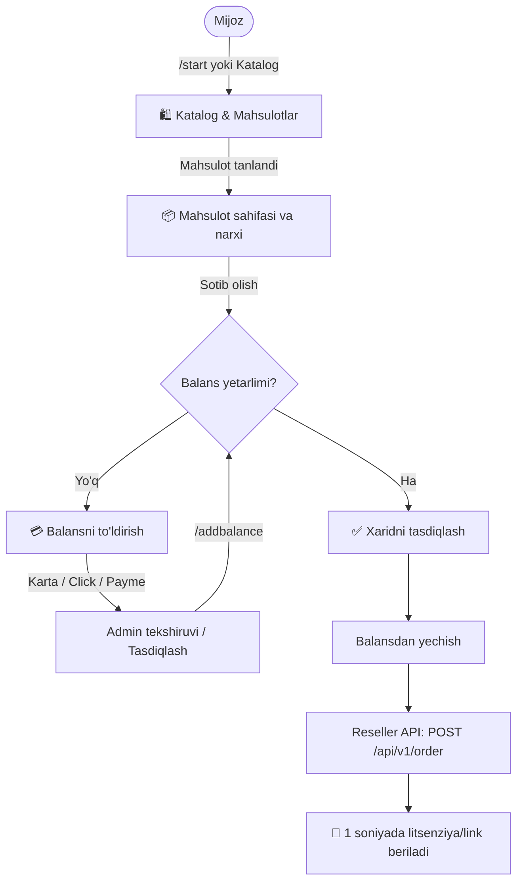

# 🚀 Sensey Store — Telegram SMM Nakrutka & AI Raqamli Obunalar Boti

Ushbu loyiha **Node.js**, **Express.js**, **Telegraf** va **SQLite (better-sqlite3)** texnologiyalari asosida qurilgan bo'lib, quyidagi 2 ta kuchli provayder bilan to'liq integratsiya qilingan:
1. **SeenSMS API (`seensms.uz`):** 1 600+ ta SMM xizmatlari (Telegram obunachi, reaksiya, ko'rish; Instagram followers, like; YouTube views; TikTok va h.k.).
2. **AIVault Hub API (`aivaulthub.store`):** AI obunalar (Gemini Plus, Duolingo Super, Adobe Express, CapCut Pro va b.).

---

## 📁 Loyiha Strukturasi

```
Sensey Bot/
├── .env                       # Asosiy sozlamalar, kartalar va API kalitlar
├── .env.example               # Namunaviy env fayli
├── package.json               # Bog'liqliklar va skriptlar
├── data/                      # SQLite ma'lumotlar bazasi saqlanadigan papka
│   └── sensey_bot.sqlite
├── src/
│   ├── config.js              # Markaziy konfiguratsiya
│   ├── index.js               # Asosiy kirish nuqtasi (Express + Bot bootstrap)
│   ├── db/
│   │   ├── index.js           # SQLite bazani ishga tushirish (WAL rejimida)
│   │   └── repository.js      # Foydalanuvchilar, buyurtmalar, SMM buyurtmalar
│   ├── services/
│   │   ├── seenSmsApi.js      # SeenSMS SMM Panel API mijozi (1600+ xizmatlar)
│   │   ├── smmService.js      # SMM kategoriyalar, hisob-kitob va saralash
│   │   ├── resellerApi.js     # AIVault Hub API mijozi (quote, order, products)
│   │   └── catalogService.js  # AI obunalar keshi va narxlari
│   ├── bot/
│   │   ├── index.js           # Telegraf bot boshqaruvi
│   │   ├── keyboards.js       # SMM va Katalog inline tugmalari
│   │   └── handlers/
│   │       ├── start.js       # /start va asosiy menyu
│   │       ├── smm.js         # SMM platformalar, kategoriyalar, buyurtma oqimi
│   │       ├── catalog.js     # AI mahsulotlar ro'yxati va xaridi
│   │       ├── profile.js     # Profil, balans, chek yuborish, buyurtmalar
│   │       └── admin.js       # Admin statistikasi, balans berish (/addbalance)
│   └── server/
│       ├── app.js             # Express.js server
│       └── routes/
│           ├── health.js      # Tizim va API holati (/health)
│           ├── payments.js    # Click va Payme to'lov webhooklari
│           └── webhooks.js    # Reseller API webhook hodisalari
```

---

## ⚙️ Sozlash va Ishga Tushirish

### 1. Bot tokenini o'rnatish
1. Telegramda [@BotFather](https://t.me/BotFather) ga kiring va `/newbot` buyrug'i orqali yangi bot yarating.
2. BotFather bergan tokenni loyihadagi `.env` fayliga kiriting:
```ini
BOT_TOKEN=1234567890:ABCdefGHIjklMNOpqrsTUVwxyz
```

### 2. Admin Telegram ID
O'zingizning Telegram ID raqamingizni aniqlang (masalan [@userinfobot](https://t.me/userinfobot) orqali) va `.env` faylida `ADMIN_ID` ga yozing:
```ini
ADMIN_ID=1118457274
```

### 3. Karta raqamini ko'rsatish (P2P to'lovlar uchun)
Mijozlar hisobni to'ldirish uchun foydalanadigan karta ma'lumotlarini kiriting:
```ini
PAYMENT_CARD_NUMBER=8600 1234 5678 9012
PAYMENT_CARD_HOLDER=FALONCHI PISTONCHIYEV
```

### 4. Ishga tushirish
Ishga tushirish uchun quyidagi komandalardan birini bajaring:

```bash
# Oddiy rejimda ishga tushirish
npm start

# O'zgarishlarni avtomat kuzatuvchi dev rejimida ishga tushirish
npm run dev
```

Server ishga tushgach:
* Express server: `http://localhost:3000`
* Tizim holati (Health check): `http://localhost:3000/health`
* Telegram bot esa avtomatik xabarlarni qabul qilishni boshlaydi.

---

## 💰 Admin Buyruqlari va Boshqaruv

Botda admin hisoblangan foydalanuvchiga (`ADMIN_ID`) maxsus imkoniyatlar ochiladi:

* `👑 Admin Boshqaruv` tugmasi — statistikani ko'rish, reseller hisobini tekshirish va omborni yangilash.
* `/addbalance <user_id> <summa>` — Istalgan foydalanuvchiga to'g'ridan-to'g'ri balans qo'shish.
  * Misol: `/addbalance 1118457274 50000`
* `/broadcast <xabar matni>` — Botdagi barcha ro'yxatdan o'tgan foydalanuvchilarga e'lon xabarini tarqatish.

---

## ⚡️ Xarid Qilish Jarayoni (Workflow)


